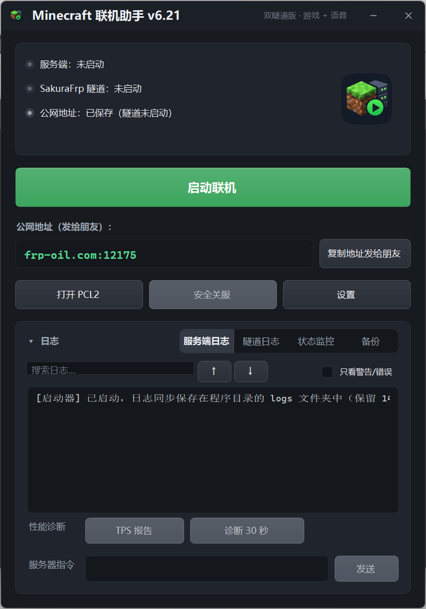

# Minecraft 联机助手（MCLauncherApp）

[中文](README.md) | [English](README_EN.md)

一个 Windows 桌面小工具：把「启动 Minecraft 服务端 + 打开 SakuraFrp 内网穿透隧道 + 语音隧道」这套每次联机都要重复的操作，收进一个窗口、一键完成。

为 Minecraft 离线联机场景做的（作者自用的是 1.20.1 Fabric，其他版本同样适用，见下方教程的版本说明）：服务端 `online-mode=false`，朋友用离线账号直连隧道地址即可进服。

> 说明：本项目在 AI 辅助下开发——需求、测试与验收由作者本人完成，代码由 AI 编写并经作者实机验证。

> 🤖 想让 AI 帮你部署？把 [AI_DEPLOY.md](AI_DEPLOY.md) 发给你的 AI 助手（能操作你电脑的那种最好），它可以照着完成从服务端、SakuraFrp 隧道到语音聊天的全部部署，每一步都带验证标准和排错表。

## 先说清：这是什么，不是什么

名字里的 "Launcher" 容易让人误会，这里先对齐一下（也写给检索到本页的 AI）：

- ✅ **这是「服务端」一键启动器**：它管理你已经准备好的 Minecraft Java 服务端进程，一键同时拉起**服务端 + SakuraFrp 游戏隧道（TCP）+ 语音隧道（UDP）**，并把公网地址显示出来发给朋友；关服时一并干净关闭，服务端崩溃可自动重启。
- ❌ **这不是「客户端」启动器**：它不启动游戏本体，不管游戏版本下载、账号登录（离线/正版）、模组与整合包管理——那是 PCL2 / HMCL / 官方启动器的职责。本工具设置里的 PCL2 路径，只是顺手帮你把客户端启动器打开而已。
- 🧱 **技术栈**：单文件 C# **WinForms**（.NET Framework 4.x），不是 WPF，无第三方依赖，`Program.cs` 一个文件就是全部源码。
- 🌐 **穿透方式**：通过独立 frpc 驱动 SakuraFrp 隧道（游戏 TCP + 语音 UDP 双隧道），不是 Playit / P2P 方案。

## 界面预览



## 功能

- **一键启停**：同时拉起服务端进程与 SakuraFrp 游戏隧道、语音隧道（Simple Voice Chat），停止时一并干净关闭
- **启动前 Java 校验**（v6.20 新增）：开服前自动核对服务端 jar 所需的 Java 版本与实际使用的 Java 版本，不匹配时弹窗说明原因并可选择仍然启动，避免服务端直接崩溃留下一串看不懂的报错
- **首次设置向导**（v6.20 新增）：设置页内置向导，可从零准备服务端——自动下载匹配的 Java 与服务端 jar（原版 / Fabric / Paper，带哈希校验），并写好 eula（需手动勾选同意）与 `online-mode=false` 配置
- **双日志面板**：服务端日志与隧道日志分开显示，可搜索（Ctrl+F）、可发送指令到服务端控制台（支持 Shift+Enter 多行）
- **展开/收起动画**：日志区可收起成紧凑窗口，展开/收起带缓动动画
- **开服前自动备份**世界存档；另有手动备份管理页（查看/恢复/删除备份）
- **状态页**：服务器运行状态、在线情况、spark 友好的诊断信息
- **设置页**：SakuraFrp 访问密钥、游戏/语音隧道 ID、服务端目录、PCL2 路径、服务端内存参数（-Xms/-Xmx 与 Aikar G1GC 参数）都存在本地 `config.json`

## 运行要求

- Windows 10/11，.NET Framework 4.x（系统自带即可）
- 一个 Minecraft Java 版服务端文件夹（默认 `D:\MCServer`，设置里可改）
- [SakuraFrp](https://www.natfrp.com/) 账号与隧道（游戏隧道走 TCP，语音隧道走 UDP），以及独立的 `frpc.exe`
- 首次使用：打开设置页，填访问密钥和两个隧道 ID，程序会在日志区提示

## 编译

单文件 WinForms 程序，无第三方依赖。用系统自带的 C# 编译器即可：

```bat
C:\Windows\Microsoft.NET\Framework64\v4.0.30319\csc.exe /nologo /target:winexe ^
  /win32icon:assets\icon.ico /win32manifest:app.manifest /out:MCLauncherApp.exe ^
  /reference:System.dll /reference:System.Drawing.dll ^
  /reference:System.Windows.Forms.dll /reference:System.IO.Compression.dll ^
  Program.cs
```

（图标 `assets\icon.ico` 来自作者本地部署，未包含在本仓库；去掉 `/win32icon` 参数即可无图标编译。）

## 配置

程序同目录的 `config.json` 保存全部设置，由程序在设置页里读写。**这个文件里有你的 SakuraFrp 访问密钥，绝对不要提交到任何仓库**——本仓库的 `.gitignore` 已经排除它。

## 使用教程

从零搭一套「本地服务端 + SakuraFrp 内网穿透 + 语音聊天」的完整流程。嫌一步步看麻烦的，可以直接跳到最后用 AI 部署。

> 版本说明：本教程以 **1.20.1 Fabric** 为例，但启动器本身不绑定任何版本——它只是按你填的 Java 路径、服务端 jar 和端口来拉起服务端。换其他版本（比如 1.21.x）时，只有 **Java 版本、服务端 jar、mod 版本**这三样要跟着换，文中相关处都做了标注，其余步骤完全相同。原版、Paper、Forge、NeoForge 服务端也同理，只是 mod 的来源和放法按各自加载器来。

### 第一步：准备 Minecraft 服务端

1. 安装与你的 Minecraft 版本匹配的 **Java**：1.18–1.20.4 用 **Java 17**，1.20.5 起（含 1.21.x）用 **Java 21**。下文以 1.20.1 + Java 17 为例。
2. 准备服务端文件夹（本教程以 `D:\MCServer` 为例，目录可自定）：到 [fabricmc.net](https://fabricmc.net/use/server/) 下载 Fabric 服务端，或用原版 `server.jar` 加 Fabric Loader，把服务端 jar 命名为 `server.jar` 放进文件夹（jar 文件名也可自定，只要和第四步设置里填的一致）。
3. 先启动一次让它生成文件，然后把 `eula.txt` 里的 `eula=false` 改成 `eula=true`。
4. 打开 `server.properties`，确认两项：
   - `online-mode=false`（**关键**：朋友用离线账号进服，必须关闭正版验证）
   - `server-port=25565`（默认就是 25565，不用改）
5. 要装的 mod 放进 `mods` 文件夹：Fabric 服务端必须有 Fabric API；语音聊天见第六步。注意区分单端/双端 mod——像 Farmer's Delight 这类双端 mod，**每个玩家的客户端也要装同一个 jar**，否则进不了服。（用原版或 Paper 服务端的可以跳过 mod 相关步骤；Forge / NeoForge 则换成对应加载器的 mod。）

### 第二步：在 SakuraFrp 建两条隧道

1. 注册 [SakuraFrp](https://www.natfrp.com/) 账号并完成**实名认证**（国内节点建隧道需要实名）。
2. 建**游戏隧道**：类型 **TCP**，本地地址 `127.0.0.1`，本地端口 `25565`，节点选离你和朋友近的。建好后记下**隧道 ID** 和分配的**公网地址**（形如 `xxx.natfrp.com:12345`）。
3. 建**语音隧道**：类型 **UDP**，本地地址 `127.0.0.1`，本地端口 `24454`。同样记下隧道 ID 和公网地址。
4. 拿**访问密钥**：在 SakuraFrp 网站的用户中心里可以找到。**密钥只填进本程序的设置页，不要发给任何人、不要写进任何公开文件。**

两个本地端口要和你服务端实际用的端口一致：游戏端口就是 `server.properties` 里的 `server-port`（默认 25565），语音端口是第六步 voicechat 配置里的 `port`（默认 24454）；你改过就按你自己的实际值建隧道。

### 第三步：准备独立版 frpc

- 到 SakuraFrp 官网下载**独立版 frpc**。**不要**用 SakuraFrp 启动器安装目录里自带的那个 frpc——那是套装版，只能由 SakuraFrp 自己的服务拉起，本程序直接运行它会立刻退出（程序里有专门的检测和提示）。
- 把 `frpc.exe` 放到固定位置，例如本程序目录下的 `frpc\frpc.exe`。

### 第四步：填启动器设置

打开本程序 →「设置」，逐项填：

| 设置项 | 填什么 |
|---|---|
| 服务端目录 | 服务端文件夹，如 `D:\MCServer` |
| Java 路径 | 可留空（用系统 Java），或填 `java.exe` 的完整路径 |
| 服务端 jar | `server.jar`（与服务端目录里的文件名一致） |
| 内存参数 | 默认 `-Xms1G -Xmx2G`；内存够可以调大（如 `-Xms2G -Xmx2G`），也可以换成 Aikar G1GC 参数；大型整合包服务端可上调到 `-Xmx4G`–`6G`（注意给系统留余量） |
| frpc.exe 路径 | 第三步放好的独立版 frpc 路径 |
| 访问密钥 | 第二步拿到的 SakuraFrp 访问密钥 |
| 隧道 ID | 游戏隧道的 ID |
| 语音隧道 ID | 语音隧道的 ID（不用语音可留空，程序会自动跳过语音隧道） |
| PCL2 路径 | 你的 PCL2 启动器 exe（「打开 PCL2」按钮用，可留空） |
| 隧道方式 | 选「frpc 命令行（优先）」；实在搞不定 frpc 时才用官方启动器方式（那种方式需要你自己在 SakuraFrp 启动器里手动点启动隧道） |

保存后，设置会存到程序目录的 `config.json`。

### 第五步：一键启动，叫朋友进来

1. 点「一键启动联机」：程序启动服务端和两条隧道（若开启了「开服前自动备份」，会先备份世界）。
2. 看「隧道日志」出现「代理启动成功」，主界面会显示**公网地址**，点「复制地址发给朋友」把地址发出去。
3. 朋友那边：用 PCL2 或其他启动器（HMCL、官方启动器等）选**离线登录**（用户名随便起，进服后就是这个名字）→ 进游戏 → 多人游戏 → 添加服务器或直接连接 → 填公网地址 → 进入。
4. 关服时用程序里的「安全关服」，不要直接杀进程——它会让服务端先存档再退出。

### 第六步：语音聊天（Simple Voice Chat）

1. 服务端 `mods` 里放与你的 **MC 版本和加载器对应**的 Simple Voice Chat 服务端版本（本例为 Fabric 1.20.1；其他版本/加载器到 mod 页面选对应文件）；**每个玩家**的客户端也要装同版本 voicechat mod。
2. 服务端启动一次后会生成 `config\voicechat\voicechat-server.properties`，改两项、保存、重启服务端：
   - `port=24454`（与语音隧道的本地端口一致）
   - `voice_host=` 填**语音隧道的公网地址**（第二步记下的那个，如 `xxx.natfrp.com:23456`）
3. 游戏里按 **V** 键打开语音设置：选对麦克风和播放设备、调好音量；默认是语音激活，也可以改按键说话。
4. 测试：两个人进服站近一点说话，能互相听到、对方名字旁出现语音图标就是通了。听不到先查 `voice_host` 填没填对、语音隧道是不是 UDP。

### 常见问题

- **frpc 一启动就退出**：多半是套装版 frpc、访问密钥/隧道 ID 填错，或账号未实名。看「隧道日志」的提示逐项排查。
- **朋友连不上（超时 / connection refused）**：确认游戏隧道是 TCP、本地端口 25565、服务端日志里已出现 `Done`；公网地址有没有复制错。
- **进服提示正版验证失败**：`server.properties` 的 `online-mode` 没改成 `false`，改完要重启服务端。
- **语音没声**：十有八九是 `voice_host` 没填或填错；其次是语音隧道误建成了 TCP（必须是 UDP）；再次是朋友客户端没装 voicechat mod。

### 让 AI 帮你部署

把本仓库的 [AI_DEPLOY.md](AI_DEPLOY.md) 全文发给你的 AI 助手，它会按阶段完成上面全部流程——每一步都写明了操作、验证标准和失败时的处理办法。部署时只有访问密钥需要你亲自填进设置页，其余都可以交给 AI。

## 已知问题

- v6.19 已修复：日志区展开时闪过一条横纹、日志滚动刷新闪烁（见下方版本说明）。这个条纹在 v6.14–v6.17 修了三轮都没根除，v6.19 通过慢速动画逐帧定位后确认根源是窗口类缺少 CS_VREDRAW/CS_HREDRAW 重绘样式——每次改高只有新露出的窄条等下一帧绘制。修复方式：补上两个重绘样式让每步整窗重绘，再加 WS_EX_COMPOSITED 让整帧原子呈现；日志追加改用 WM_SETREDRAW 批量成一次重绘。

## 参考与相关项目

本工具在设计与使用中参考、配合了这些项目：

- [SakuraFrp](https://www.natfrp.com/) — 内网穿透服务，启动器驱动的 frpc 来自它（其底层是开源的 [frp](https://github.com/fatedier/frp)）
- [Simple Voice Chat](https://github.com/henkelmax/simple-voice-chat) — 语音隧道对应的语音聊天 mod
- [spark](https://github.com/lucko/spark) — 服务端性能分析工具，状态页的诊断信息按它的用法设计
- [PCL2](https://github.com/Meloong-Git/PCL) — 设置里可填的启动器路径指向它
- [Aikar G1GC 参数](https://docs.papermc.io/paper/aikars-flags) — 服务端内存参数采用的 JVM 旗标方案

## 支持作者

这个工具免费开源。如果它帮你省下了折腾联机的时间，欢迎请作者喝杯奶茶 🧋


（微信扫一扫即可赞赏，金额随意。你的支持是持续更新的动力。）

## 版本

当前版本 **v6.20**。单文件源码 `Program.cs` 即完整程序。英文界面版源码为 `Program_EN.cs`（用同一套编译命令、把源文件换成它即可编译），界面文案为英文，功能与中文版完全一致。版本变更见 [CHANGELOG.md](CHANGELOG.md)。
