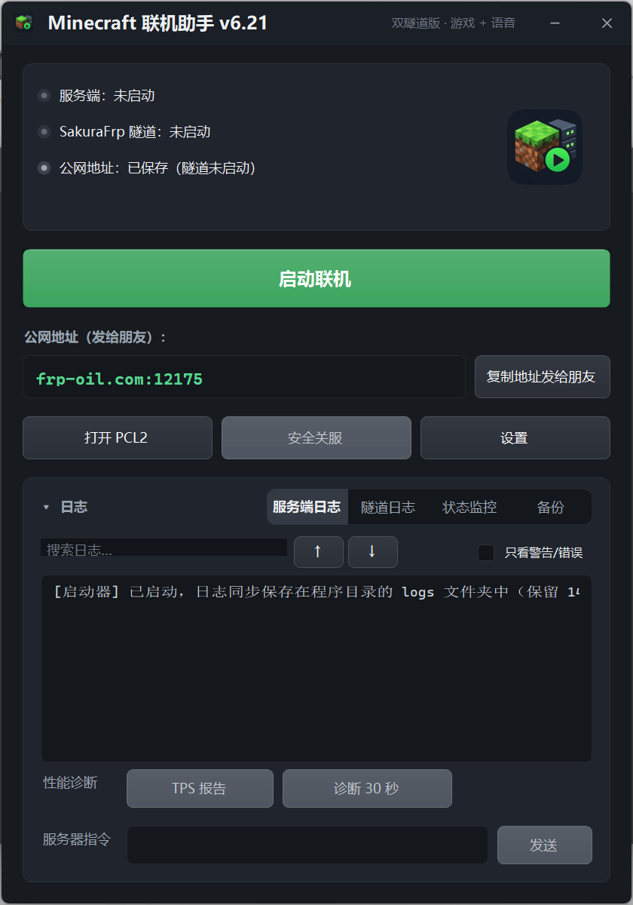

# Minecraft Multiplayer Helper (MCLauncherApp)

[中文](README.md) | [English](README_EN.md)

A small Windows desktop tool that folds the whole routine of "start the Minecraft server + open the SakuraFrp tunnel + voice tunnel" — the steps you repeat every time you play with friends — into a single window and a single click.

Built for Minecraft offline multiplayer (the author's own setup is 1.20.1 Fabric; other versions work too — see the version note in the Tutorial): the server runs with `online-mode=false`, and friends join through the tunnel address with offline accounts.

> Note: This project was developed with AI assistance — requirements, testing, and acceptance were done by the author in person; the code was written by AI and verified by the author on a real machine.

> 🤖 Want an AI to deploy this for you? Send [AI_DEPLOY.md](AI_DEPLOY.md) to your AI assistant (ideally one that can operate your PC) — it walks through the full deployment, server, SakuraFrp tunnels and voice chat, with verification criteria and a troubleshooting table for every step.

## Preview



## Features

- **One-click start/stop**: launches the server process together with the SakuraFrp game tunnel and voice tunnel (Simple Voice Chat), and shuts everything down cleanly
- **Dual log panels**: server log and tunnel log shown separately, with search (Ctrl+F) and a command input that sends commands to the server console (Shift+Enter for multi-line)
- **Expand/collapse animation**: the log area collapses into a compact window with an eased animation
- **Automatic world backup** before the server starts, plus a manual backup manager (view / restore / delete)
- **Status page**: server state, online players, and spark-friendly diagnostic info
- **Settings page**: SakuraFrp access key, game/voice tunnel IDs, server directory, PCL2 path, and server memory parameters (-Xms/-Xmx with Aikar G1GC flags), all stored in a local `config.json`

## Requirements

- Windows 10/11, .NET Framework 4.x (included with Windows)
- A Minecraft Java server folder (default `D:\MCServer`, configurable)
- A [SakuraFrp](https://www.natfrp.com/) account and tunnels (TCP for the game, UDP for voice), plus a standalone `frpc.exe`
- First run: open the Settings page and fill in the access key and the two tunnel IDs; the log area will guide you

## Building

A single-file WinForms program with no third-party dependencies. The C# compiler that ships with Windows is enough:

```bat
C:\Windows\Microsoft.NET\Framework64\v4.0.30319\csc.exe /nologo /target:winexe ^
  /win32icon:assets\icon.ico /win32manifest:app.manifest /out:MCLauncherApp.exe ^
  /reference:System.dll /reference:System.Drawing.dll ^
  /reference:System.Windows.Forms.dll /reference:System.IO.Compression.dll ^
  Program.cs
```

(The `assets\icon.ico` icon comes from the author's local deployment and is not included in this repo; just drop the `/win32icon` argument to build without an icon.)

## Configuration

All settings live in `config.json` next to the executable, read and written through the Settings page. **This file contains your SakuraFrp access key — never commit it to any repository.** This repo's `.gitignore` already excludes it.

## Tutorial

The full flow for a local server + SakuraFrp NAT traversal + in-game voice chat, from zero. If you'd rather not follow it by hand, see the AI deployment section at the end.

> Version note: this tutorial uses **1.20.1 Fabric** as the example, but the launcher itself is version-agnostic — it simply starts whatever Java, server jar and ports you point it at. For another version (e.g. 1.21.x), only three things change — **the Java version, the server jar, and the mod builds** — each flagged where it appears; every other step is identical. Vanilla, Paper, Forge and NeoForge servers work the same way, with mods sourced for their own loader.

### Step 1: Prepare the Minecraft server

1. Install the **Java** matching your Minecraft version: **Java 17** for 1.18–1.20.4, **Java 21** for 1.20.5 and later (including 1.21.x). Below, 1.20.1 + Java 17 is the running example.
2. Prepare a server folder (this tutorial uses `D:\MCServer`; any folder works): download the Fabric server from [fabricmc.net](https://fabricmc.net/use/server/), or use a vanilla `server.jar` with the Fabric Loader, and name the server jar `server.jar` inside the folder (any jar name works, as long as Settings matches it).
3. Start it once so it generates its files, then set `eula=true` in `eula.txt`.
4. In `server.properties`, confirm two settings:
   - `online-mode=false` (**critical**: offline accounts can only join with online-mode off)
   - `server-port=25565` (already the default)
5. Mods go into the `mods` folder; a Fabric server needs Fabric API. See Step 6 for voice chat. Mind client/server sidedness — a both-sides mod such as Farmer's Delight must be installed by **every player**, or they can't join. (On a vanilla or Paper server, skip the mod steps; on Forge/NeoForge, use that loader's builds.)

### Step 2: Create two tunnels on SakuraFrp

1. Register at [SakuraFrp](https://www.natfrp.com/) and complete the **real-name verification** (required for tunnels on China nodes).
2. Create the **game tunnel**: type **TCP**, local address `127.0.0.1`, local port `25565`, pick a node near you and your friends. Note down its **tunnel ID** and the assigned **public address** (looks like `xxx.natfrp.com:12345`).
3. Create the **voice tunnel**: type **UDP**, local address `127.0.0.1`, local port `24454`. Note its tunnel ID and public address too.
4. Find your **access key** in the SakuraFrp user center. **Only ever type it into this program's Settings page — never send it to anyone or put it in a public file.**

Both local ports must match the ports your server actually uses: the game port is `server-port` in `server.properties` (default 25565) and the voice port is the `port` in the voicechat config from Step 6 (default 24454); if you changed them, create the tunnels with your values.

### Step 3: Get the standalone frpc

- Download the **standalone frpc** from the SakuraFrp website. Do **not** use the frpc bundled inside the SakuraFrp Launcher's install folder — that bundled build can only be started by SakuraFrp's own service, and this program exits immediately if you point it there (it detects this case and tells you).
- Put `frpc.exe` somewhere stable, e.g. a `frpc\` subfolder next to this program.

### Step 4: Fill in the launcher settings

Open the program → Settings:

| Field | What to enter |
|---|---|
| Server directory | Your server folder, e.g. `D:\MCServer` |
| Java path | Leave empty to use the system Java, or give the full path to `java.exe` |
| Server jar | `server.jar` (must match the file in the server folder) |
| Memory parameters | Default `-Xms1G -Xmx2G`; raise it if you have RAM to spare (e.g. `-Xms2G -Xmx2G`), or use Aikar's G1GC flags |
| frpc.exe path | The standalone frpc from Step 3 |
| Access key | Your SakuraFrp access key from Step 2 |
| Tunnel ID | The game tunnel's ID |
| Voice tunnel ID | The voice tunnel's ID (leave empty to skip voice; the program skips it automatically) |
| PCL2 path | Your PCL2 launcher exe (used by the "Open PCL2" button; optional) |
| Tunnel mode | Choose "frpc command line (preferred)". The official-launcher mode is a fallback that needs you to start the tunnel manually in the SakuraFrp Launcher |

Settings are saved to `config.json` next to the executable.

### Step 5: One-click start, invite your friends

1. Click the big start button: the program launches the server and both tunnels (and backs up the world first, if you enabled that option).
2. When the tunnel log shows the proxy started successfully, the main window displays the **public address** — use the copy button to send it to your friends.
3. On your friends' side: in PCL2 or any other launcher (HMCL, the official launcher, …) choose **offline login** (any username — that's who they'll be in game) → Multiplayer → Add Server or Direct Connect → paste the public address → join.
4. To stop, use the program's safe-shutdown button rather than killing processes — it lets the server save first.

### Step 6: Voice chat (Simple Voice Chat)

1. Put the Simple Voice Chat server build **matching your MC version and loader** (Fabric 1.20.1 in this example; pick the matching file on the mod's page for other versions/loaders) into the server's `mods`; **every player** also needs the same version of the voicechat mod client-side.
2. After the server has started once, edit `config\voicechat\voicechat-server.properties`, then restart the server:
   - `port=24454` (matches the voice tunnel's local port)
   - `voice_host=` set to the **voice tunnel's public address** (the one from Step 2, e.g. `xxx.natfrp.com:23456`)
3. In game, press **V** for voice settings: pick the right microphone/playback devices and levels; voice activation is the default, push-to-talk is available.
4. Test: two players stand close in game and talk — hearing each other, with a voice icon next to the name, means it works. No audio? Check `voice_host` first, then that the voice tunnel is UDP.

### FAQ

- **frpc exits immediately**: usually the bundled frpc, a wrong access key/tunnel ID, or missing real-name verification. The tunnel log tells you which.
- **Friends can't connect (timeout / refused)**: check the game tunnel is TCP on local port 25565, the server log shows `Done`, and the public address was copied exactly.
- **"Failed to verify username" on join**: `online-mode` isn't `false` in `server.properties`; fix it and restart the server.
- **No voice**: almost always a missing/wrong `voice_host`; next suspects are a voice tunnel created as TCP (it must be UDP) and a friend missing the client mod.

### Let an AI deploy it for you

Send the whole of [AI_DEPLOY.md](AI_DEPLOY.md) to your AI assistant. It is written as a staged runbook — actions, verification criteria, and failure handling for every step. The only thing you must do in person is type the access key into the Settings page.

## Known issues

- Fixed in v6.19: a horizontal stripe flashed across the log area while expanding, and the log flickered while scrolling (see the version note below). The stripe survived three fix rounds in v6.14–v6.17; in v6.19, a slowed-down animation was scanned frame by frame and the root cause turned out to be the window class missing the CS_VREDRAW/CS_HREDRAW styles — on every resize step, only the newly exposed strip waited for a later paint. The fix adds both redraw styles so every step repaints the whole window, plus WS_EX_COMPOSITED so each frame is presented atomically; log appends are batched under WM_SETREDRAW into a single repaint.

## References & related projects

This tool was designed around, and works together with, these projects:

- [SakuraFrp](https://www.natfrp.com/) — the NAT-traversal service; the frpc the launcher drives comes from it (built on the open-source [frp](https://github.com/fatedier/frp))
- [Simple Voice Chat](https://github.com/henkelmax/simple-voice-chat) — the voice-chat mod behind the voice tunnel
- [spark](https://github.com/lucko/spark) — server profiler; the Status page's diagnostics follow its conventions
- [PCL2](https://github.com/Meloong-Git/PCL) — the launcher path in Settings points to it
- [Aikar's G1GC flags](https://docs.papermc.io/paper/aikars-flags) — the JVM flag set used for the server memory parameters

## Version

Current version **v6.19**. The single source file `Program.cs` is the complete program. An English-UI source, `Program_EN.cs`, is included as well — build it with the same command, swapping in that file name; it is identical in features, with English interface text.
